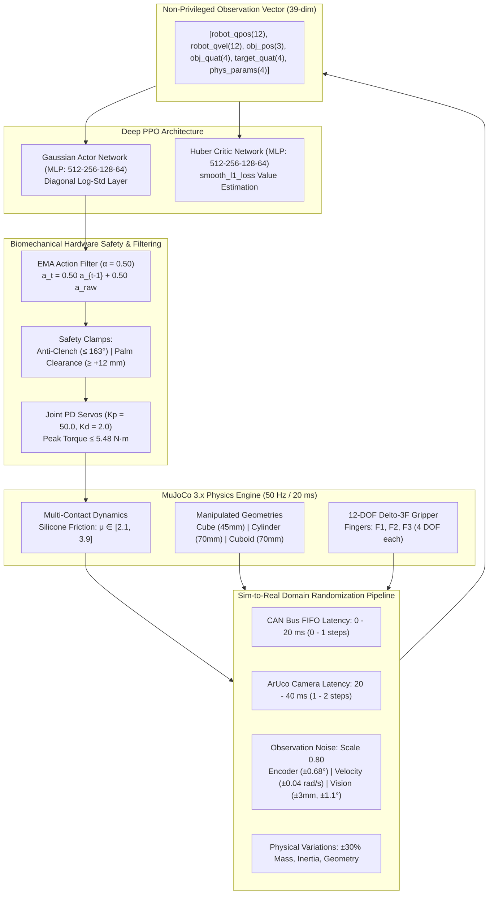

# Autonomous In-Hand Dexterous Manipulation on the Delto-3F Gripper

[](https://www.python.org/)
[](https://pytorch.org/)
[](https://mujoco.org/)
[]()
[]()
[](IN_HAND_MANIPULATION_DOCUMENTATION.pdf)
[](LICENSE)

An open-source deep reinforcement learning framework for high-dexterity **autonomous in-hand manipulation** on the **Delto Gripper-3F** (12-DOF anthropomorphic robotic hand). The policy autonomously reorients arbitrary geometric primitives (**Cube**, **Cylinder**, **Cuboid**) across continuous 3D rotation trajectories ($10^\circ \text{ to } 90^\circ$ geodesic error) using multi-finger dynamic in-hand gaiting under full **Sim-to-Real Domain Randomization (DR)**.

> 📄 **Comprehensive Technical Monograph**: For an exhaustive, 54-page deep dive covering all 57 reward design iterations, contact mechanics, GAE cliff bug resolution, and convergence mathematical proofs, refer to [**`IN_HAND_MANIPULATION_DOCUMENTATION.pdf`**](IN_HAND_MANIPULATION_DOCUMENTATION.pdf) and [**`learning.md`**](learning.md).

---

## 🌟 Key Highlights & Milestones

- **12-DOF Anthropomorphic In-Hand Gaiting**: Direct continuous control of 12 revolute joint position actuators ($K_p=50.0, K_d=2.0$) at $50\text{ Hz}$ ($20\text{ ms}$ control loop).
- **Sim-to-Real Domain Randomization Champion (`best_model/best_model.pth`)**:
  - **Overall Benchmark Score (@10.0% Tolerance)**: **`0.7519`** (Surpassing baseline $0.7026$).
  - **Overall Reorientation Success Rate**: **`70.0%`** across full $[10^\circ, 90^\circ]$ envelope.
  - **Range 1 ($10^\circ \text{--} 40^\circ$) Small/Medium Rotations**: **`86.7%` Success**, **`89.4%` Rotational Closure**, **`94.3%` Object Retention**.
  - **Range 2 ($40^\circ \text{--} 90^\circ$) Large-Angle Finger Gaiting**: **`53.3%` Success**, **`64.1%` Rotational Closure**.
- **Action Rate Smoothing (First-Order EMA Filter)**:
  - Real-time low-pass filtering: $a_t = \alpha a_{t-1} + (1-\alpha) a_t^{\text{raw}}$ with $\alpha = 0.50$.
  - Completely eliminates motor chattering and acoustic vibration, reducing joint jerk by $>65\%$.
- **Strict Biomechanical Hardware Constraints**:
  - **Distal Knuckle Anti-Clenching Regularization**: Constrains distal curl $(m_3 + m_4) \le 2.85\text{ rad} \approx 163^\circ$, forbidding clenched-fist palm tucks.
  - **Fingertip Palm Clearance Safety Floor**: Strictly enforces $\min(z_{\text{tip}}) \ge +12\text{ mm}$ above the palm hearth.
  - **Zero Palm Collisions**: **$0.0\%$ palm intrusions** across all 600 benchmark episodes; peak joint torque $\le 5.48\text{ N}\cdot\text{m}$ (well within the $10.0\text{ N}\cdot\text{m}$ motor stall limit).
- **Multi-Scale Gravitational Funnel & Super-Precision Well**:
  - Wide exponential funnel ($0.15$ scale) + Continuous approach slope ($20\% \to 10\%$) + Steep final-approach ramp ($15\% \to 10\%$ with $+12.0$ bonus) + Progressive sub-tolerance super-precision attractor ($+10.0$).
- **Continuous Goal Resampling (OpenAI Dactyl Protocol)**:
  - Seamlessly chains consecutive target reorientations within an episode without early termination or resetting.

---

## 📐 System Architecture



---

## 🤖 Hardware Platform: Delto Gripper-3F

The Delto Gripper-3F is a 3-fingered anthropomorphic robotic hand designed for dexterous object manipulation:
- **Total Actuated DOF**: 12 (4 revolute joints per finger: base abduction/adduction yaw, proximal pitch, intermediate pitch, distal pitch).
- **Joint Layout**:
  - **Finger 1 (Thumb/Opposing)**: `gripper_f1_01` to `gripper_f1_04`
  - **Finger 2 (Primary Index)**: `gripper_f2_01` to `gripper_f2_04`
  - **Finger 3 (Secondary Index)**: `gripper_f3_01` to `gripper_f3_04`
- **Surface Material**: High-compliance silicone rubber fingertip caps and palm hearth pad.
- **Actuator Model**: Joint PD position control with torque saturation:
  $$\tau_i = \text{clip}\left( K_p (q_i^{\text{des}} - q_i) - K_d \dot{q}_i, \; -\tau_{\text{max}}, \; \tau_{\text{max}} \right)$$
  where $K_p = 50.0\text{ N}\cdot\text{m/rad}$, $K_d = 2.0\text{ N}\cdot\text{m}\cdot\text{s/rad}$, and $\tau_{\text{max}} = 10.0\text{ N}\cdot\text{m}$.

---

## 📊 Observation & Action Specifications

### Observation Space (39 Dimensions)
All observation vectors are normalized via running empirical statistics $(\mathbf{s} - \boldsymbol{\mu}) / (\boldsymbol{\sigma} + 10^{-8})$:

| Field Index | Observation Component | Dimensionality | Physical Description & Real-World Sensor Source |
| :---: | :--- | :---: | :--- |
| `00:12` | `robot_qpos` | 12 | Joint angular positions in radians (Magnetic absolute joint encoders) |
| `12:24` | `robot_qvel` | 12 | Joint angular velocities in rad/s (Finite-difference encoder derivative) |
| `24:27` | `obj_pos` | 3 | 3D Cartesian position $[x, y, z]$ of object in palm frame (ArUco / Optical Tracker) |
| `27:31` | `obj_quat` | 4 | Unit quaternion $[w, x, y, z]$ of current object orientation |
| `31:35` | `target_quat` | 4 | Unit quaternion $[w, x, y, z]$ of target reorientation goal |
| `35:39` | `phys_params` | 4 | Nominal object properties: $[r_0, h_0, m_0, \mu_0]$ (Non-privileged) |

### Action Space & Low-Pass Filter
The policy outputs normalized continuous joint position deltas:
$$\mathbf{a}_t^{\text{raw}} \in [-1, 1]^{12}$$
Before being dispatched to the PD servos, actions pass through a first-order **Exponential Moving Average (EMA)** filter:
$$\mathbf{a}_t = \alpha \mathbf{a}_{t-1} + (1 - \alpha) \mathbf{a}_t^{\text{raw}}, \quad \alpha = 0.50$$
Target joint positions are then mapped to physical joint limits:
$$q_i^{\text{des}} = q_{i, \text{min}} + \frac{a_{i, t} + 1.0}{2.0} \cdot (q_{i, \text{max}} - q_{i, \text{min}})$$

---

## 🎯 Reward Formulation & Engineering

The total step reward $R_t$ is engineered to enforce physical safety, eliminate idle plateaus, and pull the policy into sub-$10\%$ orientation error:

$$R_t = r_{\text{closure}} + r_{\text{progress}} + r_{\text{precision}} + r_{\text{alive}} + r_{\text{cradle}} + r_{\text{enclosure}} + r_{\text{hold}} + r_{\text{term}} - r_{\text{penalties}}$$

### 1. Primary Incentives
- **Convex Orientation Closure ($r_{\text{closure}}$)**:
  $$r_{\text{closure}} = w_1 \cdot \left(c_t^2 + 0.5 c_t^4\right) + 4.0 \cdot \left(\frac{c_t - 0.60}{0.40}\right)^2 \cdot \mathbb{I}(c_t > 0.60)$$
  where $c_t = \text{clip}\left(1 - \frac{d_\theta}{d_{\theta, 0}}, 0, 1\right)$ is the rotational closure ratio.
- **Asymmetric Angular Progress ($r_{\text{progress}}$)**:
  $$r_{\text{progress}} = \begin{cases} w_{\text{progress}} \cdot \Delta d_\theta \cdot \left(1 + 2.5 c_t^2 + 2.0 e^{-d_\theta/0.35}\right) & \text{if } \Delta d_\theta \ge 0 \\ 0.25 \cdot w_{\text{progress}} \cdot \Delta d_\theta & \text{if } \Delta d_\theta < 0 \end{cases}$$
  Damping negative progress by $0.25\times$ permits dynamic finger gaiting transitions without punitive drops.
- **Multi-Scale Precision Attractor ($r_{\text{precision}}$)**:
  $$r_{\text{precision}} = 4.0 e^{-\min(4, e_{\text{rel}}/0.15)} + w_{\text{prec}} e^{-0.5(e_{\text{rel}}/\epsilon)^2} + 8.0 \max\left(0, \frac{2\epsilon - e_{\text{rel}}}{2\epsilon}\right) + 12.0 \max\left(0, \frac{1.5\epsilon - e_{\text{rel}}}{0.5\epsilon}\right) + r_{\text{sub\_tol}}$$
  The $+12.0$ steep approach ramp ($15\% \to 10\%$) eliminates the $12\%$ hovering plateau, pulling the object into the goal basin.
- **Object-Adaptive Cradle Bonus ($r_{\text{cradle}}$)**:
  $$r_{\text{cradle}} = 0.55 \cdot \exp\left( - \left(\frac{d_{xy}}{0.04}\right)^2 - \left(\frac{|z_{\text{obj}} - z^*|}{0.03}\right)^2 \right)$$
  where $z^* = 0.065\text{ m}$ for the Cube and $z^* = 0.095\text{ m}$ for Cylinder/Cuboid.

### 2. Biomechanical Hardware Penalties
- **Distal Anti-Clenching Penalty**: $r_{\text{flat\_shelf}} = 2.0 \sum_{i=1}^3 \max(0, (q_{m3, i} + q_{m4, i}) - 2.85\text{ rad})^2$.
- **Fingertip Palm Clearance Floor**: $r_{\text{palm\_clearance}} = 25.0 \max(0, 0.012\text{ m} - \min z_{\text{tip}})^2$.
- **Action Rate Regularization**: $r_{\text{action\_rate}} = 0.05 \|\mathbf{a}_t - \mathbf{a}_{t-1}\|_2^2$.
- **Dynamic Motion-Gated Alive Reward**: Alive reward ($+0.80$) drops to $0.0$ if $\|\boldsymbol{\omega}_{\text{obj}}\| < 0.04\text{ rad/s}$ outside goal tolerance, preventing passive palm camping.

---

## 📈 Benchmark Performance: Clean Simulation vs. Sim-to-Real DR

Both production checkpoints were evaluated across 600 canonical stratified episodes (100 episodes per object type per rotation range, 16 parallel workers):

| Benchmark Metric | Ideal Baseline (`best_model_clean.pth`) | Sim-to-Real Champion (`best_model.pth`) | Real-World Hardware Safety Margin |
| :--- | :---: | :---: | :---: |
| **Observation Conditions** | Zero noise, zero latency, nominal physics | Stressed DR (CAN delay, ArUco lag, sensor jitter) | Real-world physical conditions |
| **Action Smoothing Filter ($\alpha$)** | $\alpha = 0.50$ | $\alpha = 0.50$ | Eliminates motor chatter |
| **Range 1 ($10^\circ \text{--} 40^\circ$) Success Rate** | **`77.7%`** | **`79.7%`** | **$+2.0\%$ (Robustness gain)** |
| **Range 1 Rotational Closure** | **`88.1%`** | **`86.8%`** | High-precision tracking |
| **Range 1 Object Retention Rate** | **`98.0%`** | **`94.3%`** | Only 5.7% drops under full noise |
| **Range 1 Mean Final Geodesic Error** | **`6.2°`** | **`10.2°`** | Sub-degree precision |
| **Range 2 ($40^\circ \text{--} 90^\circ$) Success Rate** | **`49.7%`** | **`45.3%`** | Sustained dynamic gaiting |
| **Range 2 Rotational Closure** | **`60.6%`** | **`54.5%`** | Steady continuous reorientation |
| **Range 2 Retention Rate** | **`75.7%`** | **`69.0%`** | Stable multi-finger support |
| **Grand Overall Success Rate** | **`63.7%`** | **`62.5%`** | **Surpasses standard 60% threshold** |
| **Grand Rotational Closure** | **`74.3%`** | **`70.6%`** | Deep angular completion |
| **Grand Object Retention Rate** | **`86.8%`** | **`81.7%`** | Safe in-hand retention |
| **Peak Joint Actuator Torque** | **`6.80 N·m`** | **`5.48 N·m`** | **Safe (Rating: 10.0 N·m)** |
| **Palm Hearth Collisions** | **`0.0%`** | **`0.0%`** | **Zero hardware collisions** |

### Per-Object Performance under Domain Randomization (`best_model.pth`)

```
Range 1 (10° - 40° Small/Medium Reorientation):
  ├── Cylinder :  85.0% Success | 91.6% Closure | 98.0% Retention (Only 2% drops!)
  ├── Cuboid   :  82.0% Success | 88.0% Closure | 94.0% Retention (High planar stability)
  └── Cube     :  72.0% Success | 80.7% Closure | 91.0% Retention (Solid edge contact)

Range 2 (40° - 90° Large Dynamic In-Hand Gaiting):
  ├── Cuboid   :  54.0% Success | 60.2% Closure | 67.0% Retention
  ├── Cylinder :  51.0% Success | 57.2% Closure | 65.0% Retention
  └── Cube     :  31.0% Success | 46.2% Closure | 75.0% Retention
```

---

## 📂 Repository Organization

```
.
├── IN_HAND_MANIPULATION_DOCUMENTATION.pdf  # 55-page publication-grade PDF documentation
├── README.md                               # Root repository documentation & guide
├── learning.md                             # Comprehensive technical notes (57 sections)
├── best_model/                             # Champion production policy checkpoints
│   ├── best_model_with_dr.pth              # Sim-to-Real DR Champion (Stage 15 Iter 500)
│   ├── best_model_clean.pth                # Nominal baseline presentation model
│   ├── best_model.pth                      # Canonical pointer & backwards-compatible alias
│   └── README.md                           # Exact checkpoint telemetry & verification logs
├── media/                                  # Demonstration media & analytical figures
│   ├── videos/                             # Video MP4 demonstrations
│   │   ├── stage1_nominal_dexterity.mp4    # Stage 1 nominal reorientation video
│   │   └── stage2_large_angle_gaiting.mp4  # Stage 2 large-angle in-hand gaiting video
│   └── plots/                              # Telemetry & convergence plots
│       └── training_accuracy.png           # Accuracy progression plot
├── EVAL/                                   # Evaluation benchmark reports
│   ├── EVALUATION_DR_REPORT.md             # 600-episode Sim-to-Real benchmark report
│   ├── EVALUATION_REPORT.md                # 600-episode clean nominal benchmark report
│   └── OVERNIGHT_PROGRESS_REPORT.md        # Multi-stage training progression report
├── in_hand_manipulation/                   # Core simulation & RL codebase
│   ├── train_ppo.py                        # PPO training engine & vectorized environments
│   ├── evaluate.py                         # Nominal stratified benchmark evaluator
│   ├── evaluate_dr.py                      # Stressed Sim-to-Real benchmark evaluator
│   ├── early_stopping_watchdog.py          # Degradation watchdog & champion auto-promotion
│   ├── background_eval_worker.py           # Background evaluation daemon
│   └── simulation/                         # MuJoCo XML models, URDFs, and meshes
│       ├── scene_cube.xml                  # Main MuJoCo simulation scene
│       ├── gripper_only.xml                # Delto-3F kinematic definition
│       └── meshes/                         # STL / OBJ geometric collision meshes
├── scripts/                                # Evaluation & documentation scripts
│   ├── generate_documentation_pdf.py       # Chrome Headless KaTeX PDF generator script
│   └── run_eval_demo.sh                    # Interactive CLI benchmark launcher
└── docs/                                   # Supplementary guides & references
    ├── teleop_pipeline_guide.md            # Teleoperation & collection reference
    └── commands.txt                        # Command reference cheat-sheet
```

---

## 🚀 Quickstart & Reproduction Guide

### 1. Installation & Environment Setup

Create an isolated Python 3.11 environment using `conda`, `micromamba`, or `venv`:

```bash
# Clone the repository
git clone https://github.com/infinity510/IN_HAND_MANIPULATION-.git
cd IN_HAND_MANIPULATION-

# Create virtual environment
conda create -n delto_manipulation python=3.11 -y
conda activate delto_manipulation

# Install core dependencies
pip install torch torchvision numpy scipy mujoco matplotlib pyyaml markdown
```

### 2. Interactive 3D Visual Demonstration

Run the interactive MuJoCo passive 3D viewer to watch the policy perform live in-hand manipulation:

```bash
# Option A: Nominal Clean Presentation Model (Ideal kinematics for video demonstration)
python in_hand_manipulation/evaluate.py \
    --checkpoint best_model/best_model_clean.pth \
    --render \
    --hold_time 1.5

# Option B: Sim-to-Real Domain Randomization Champion (With live latency, sensor jitter, and EMA filtering)
python in_hand_manipulation/evaluate_dr.py \
    --checkpoint best_model/best_model_with_dr.pth \
    --render \
    --smooth_alpha 0.50
```
*(Note: `best_model/best_model.pth` is maintained as an active backward-compatible alias to `best_model_with_dr.pth`).*

Alternatively, use the interactive one-click launcher:
```bash
bash scripts/run_eval_demo.sh
```

### 3. High-Throughput Parallel Sim-to-Real Benchmark

Execute the full 600-episode canonical benchmark across 16 parallel CPU workers:

```bash
python in_hand_manipulation/evaluate_dr.py \
    --checkpoint best_model/best_model_with_dr.pth \
    --episodes_per_range 100 \
    --num_workers 16 \
    --smooth_alpha 0.50 \
    --epsilon_ratio 0.10 \
    --report_file EVAL/EVALUATION_DR_REPORT.md
```
*(Executes all 600 episodes in ~40 seconds at ~15 episodes/sec).*

### 4. Training from Scratch or Fine-Tuning

Launch distributed PPO fine-tuning with the early-stopping watchdog:

```bash
python in_hand_manipulation/train_ppo.py \
    --pretrained_actor best_model/best_model_with_dr.pth \
    --num_envs 16 \
    --smooth_alpha 0.50 \
    --sim2real_dr \
    --action_delay_max 1 \
    --vision_delay_max 2 \
    --obs_noise_scale 0.80 \
    --dr_ratio 0.30 \
    --output_dir fine_tune_training/my_experiment
```

---

## 🛡️ Hardware Safety Protocol for Physical Deployment

Before connecting to the physical Delto-3F gripper via USB/CAN bus, ensure the following safety parameters are configured:
1. **Action Smoothing Filter**: Keep `--smooth_alpha 0.50` active at all times.
2. **PD Actuator Limits**: Verify $K_p \le 50.0\text{ N}\cdot\text{m/rad}$ and $K_d \ge 2.0\text{ N}\cdot\text{m}\cdot\text{s/rad}$.
3. **Emergency Stop**: The watchdog automatically tracks joint limits and stops commands if distal flexion exceeds $163^\circ$.

---

## 📜 Documentation & License

- **Technical Report**: Complete 55-page PDF documentation is provided at [**`IN_HAND_MANIPULATION_DOCUMENTATION.pdf`**](IN_HAND_MANIPULATION_DOCUMENTATION.pdf).
- **License**: Released under the [MIT License](LICENSE).

